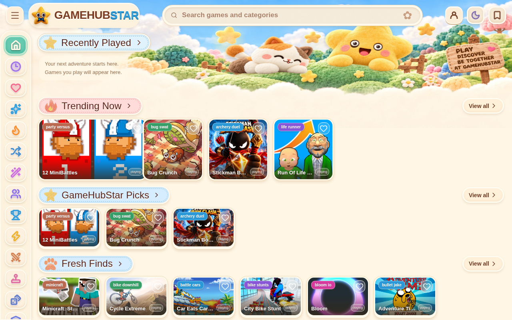

# [GameHubStar](https://gamehubstar.com)

▶️ **Play now: https://gamehubstar.com**

Free browser games that play instantly — no download, no signup.

A growing collection of puzzle, arcade, sports, shooting and more, tested on desktop and mobile. New games added daily.

## Architecture

GameHubStar runs on a zero-server-cost stack:

- **Hosting:** GitHub Pages serves the static frontend (React + Vite SPA).
- **API:** Cloudflare Workers serve the game catalog API.
- **Database:** Cloudflare D1 (SQLite at the edge) stores the game catalog — titles, categories, thumbnails, source links, orientation and device-support flags.
- **Games:** HTML5 games are embedded from GameMonetize; the site hosts no game files itself.
- **Content pipeline:** new games are added daily by an automated pipeline — real playtesting on desktop and mobile, original review copy, sitemap and static page generation.

The only fixed cost is the domain — gamehubstar.com, $10.46/year. No servers to maintain, scale, or pay for.
